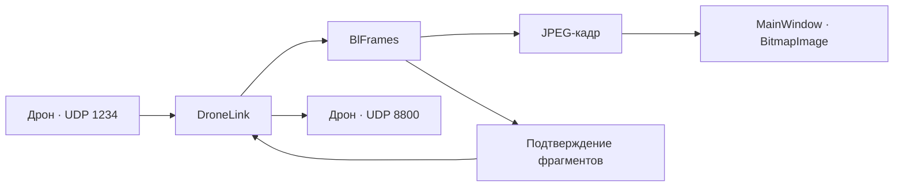

# Архитектура

[README](../readme.md) · [Геймпад](GAMEPAD.md) · [Протокол](PROTOCOL.md)

Приложение объединяет интерфейс WPF, обработку ввода и UDP-клиент в одном процессе. Видео и полётные команды используют одно соединение с дроном. Формирование пакетов и расчёт осей отделены от интерфейса и проверяются независимо.

## Структура проекта

```text
src/DroneControl/           WPF-приложение
    Controls/              Экранные стики
    Styles/                Стили Material Design
    Headers/               Заголовки JPEG для поддерживаемых уровней качества
tests/DroneControl.Tests/   Исполняемый набор проверок
docs/                      Документация
DroneControl.slnx           Решение .NET
```

Тестовый проект подключает исходные файлы протокола, транспорта и модели ввода через `Compile Include` с `Link`. Тесты этих компонентов не зависят от WPF, SDL или физического геймпада. Заголовки JPEG встроены в ресурсы WPF-приложения.

## Основные компоненты

| Компонент | Назначение |
| :--- | :--- |
| `MainWindow` | Состояние интерфейса, подключение, таймер команд и отображение видео |
| `Joystick` | Аналоговый экранный стик с захватом мыши или касания |
| `SdlGamepad` | Поиск устройства, чтение осей и кнопок через SDL3-CS |
| `GamepadInput` | Нормализация осей, мёртвая зона и проверка центрирования |
| `GamepadButtonInput` | Разовые нажатия и приоритеты команд |
| `FlightInput` | Состояние четырёх осей и преобразование их в полётную команду |
| `Protocol` | Форматы команд, BL-оболочка и heartbeat |
| `DroneLink` | Отправка и приём UDP, фильтрация пакетов и состояние связи |
| `BlFrames` | Сборка фрагментов в JPEG и формирование подтверждений |

`App.xaml` и `Styles/Controls.xaml` определяют ресурсы и оформление. `MainWindow.xaml` содержит компоновку и привязки элементов управления.

## Приём видео



При подключении `MainWindow` создаёт `DroneLink` и `BlFrames`. Транспорт проверяет адрес отправителя и заголовок BL, затем передаёт пакет обработчику `Reply`. Сборщик возвращает готовый JPEG либо `null`; подтверждение фрагментов транспорт отправляет обратно дрону.

`BlFrames` хранит не более четырёх незавершённых кадров размером до 1 МиБ каждый. Повторные фрагменты не увеличивают счётчик, пакеты с несовместимыми метаданными отбрасываются. Сборщик вызывается последовательно из цикла приёма.

`ShowFrame` ставит в очередь `Dispatcher` не более одной задачи отображения. Это ограничивает задержку, если интерфейс не успевает показывать все кадры. Перед отображением проверяется принадлежность кадра текущему соединению. JPEG загружается с `BitmapCacheOption.OnLoad`, поэтому исходный поток закрывается сразу после декодирования.

## Обработка ввода

Экранные стики и геймпад используют одну модель `FlightInput`: левый стик задаёт газ и поворот, правый — тангаж и крен. Каждая пара осей ограничена единичным кругом. Диапазоны команд описаны в [протоколе](PROTOCOL.md#оси-и-скорость).

Экранный `Joystick` хранит владельца захвата: мышь или отдельный `TouchDevice`. Отпускание, потеря захвата и отключение контрола возвращают его оси в нейтраль. Метод `Display` обновляет только положение индикатора — он используется для отображения состояния геймпада.

### Геймпад

`SdlGamepad` инициализирует подсистему SDL Gamepad при первом чтении. Вызовы выполняются на UI-потоке; состояние обновляется через `SDL.UpdateGamepads` в таймере WPF. SDL-события отключены, дополнительное окно SDL не создаётся.

Приложение читает стандартизованные оси `LeftX`, `LeftY`, `RightX`, `RightY` и кнопки `LeftShoulder`, `DPadUp`, `DPadDown`, `East`. Раскладку конкретного устройства определяет SDL. Поиск отключённого устройства выполняется не чаще раза в секунду.

`GamepadInput` инвертирует ось Y, нормализует значения и применяет радиальную мёртвую зону 18%. После включения управления оба стика должны оставаться в центре 300 мс. Отклонение до завершения этого интервала начинает отсчёт заново.

`GamepadButtonInput` хранит историю кнопок отдельно от состояния стиков. Действие возникает только при новом нажатии. Первый снимок после подключения или сброса становится исходным состоянием: уже зажатая кнопка не вызывает команду. История обновляется и при выключенном управлении, поэтому отклонённые команды не исполняются позже.

## Соединение и таймеры

| Параметр | Значение |
| :--- | :--- |
| Период таймера WPF | 50 мс |
| Срок следующего heartbeat | Через 110 мс после предыдущего; отправка на ближайшем вызове таймера |
| Таймаут свежести ответа | 3 с |
| Длительность взлёта, посадки и остановки | 1 с |

`DispatcherTimer` вызывает асинхронный обработчик. Флаг `isTickRunning` предотвращает повторный вход, если предыдущая отправка ещё не завершилась. Интервалы отсчитываются монотонно; частота отправки зависит от загрузки UI-потока.

`DroneLink` запускает цикл `ReceiveAsync` в конструкторе. Отдельный поток приёма не создаётся: при создании из WPF продолжения `await` возвращаются на UI-поток. Обработчики `Reply` и `Error` вызываются из цикла приёма и не должны блокировать его.

Состояние `Responding` означает, что цикл приёма активен и допустимый пакет получен менее трёх секунд назад. Ошибка приёма сбрасывает это состояние и завершает цикл. Автоматическое переподключение не предусмотрено.

## Разрешение управления

Ненулевые оси геймпада передаются в `FlightInput` только при активном окне, включённом управлении и завершённом центрировании. Индикаторы стиков могут работать отдельно от отправки команд.

Потеря фокуса, смена источника, отключение геймпада и истечение таймаута связи выключают управление и сбрасывают оси. Повторное включение выполняется вручную.

Взлёт и посадка требуют свежего ответа дрона и разрешённого ввода. Команда остановки с кнопки B требует только открытого соединения и имеет приоритет над остальными действиями. Начавшийся секундный импульс остановки сохраняется при смене источника и потере фокуса; повторное включение управления до его завершения блокируется.

## Завершение работы

При отключении окно сбрасывает ввод и дожидается завершения текущего вызова таймера. Если полётные команды уже отправлялись, приложение пытается передать нейтраль и команду выхода `65`. Затем `DisposeAsync` отменяет приём, закрывает сокет и ожидает завершения задачи транспорта. Повторный вызов ожидает ту же задачу закрытия.

Флаг `HasControlActivity` устанавливается до первой отправки, а запрос нейтрали `shouldSendNeutral` снимается перед `await`. Это сохраняет запрос сброса, возникший во время незавершённой отправки. При закрытии окна также останавливается таймер и освобождается подсистема SDL.

Команды сборки, тестирования и публикации приведены в [README](../readme.md#сборка-и-тесты).
