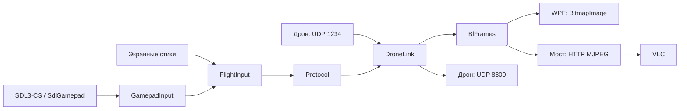

# Архитектура

## Проекты

Решение `DroneControl.slnx` содержит три проекта:

| Проект | Назначение |
|---|---|
| src/DroneControl | WPF-интерфейс, ввод, код протокола и UDP-транспорт |
| src/DroneVideoBridge | Консольный видеомост UDP → HTTP MJPEG |
| tests/DroneControl.Tests | Исполняемый набор проверок без тестового NuGet-фреймворка |

Мост и тесты подключают общие `.cs` через `Compile Include` с `Link`. Общая библиотека пока не выделена. `Protocol`, `DroneLink` и `BlFrames` компилируются во все три проекта; `FlightInput` и `GamepadInput` также подключены к тестам. SDL3-CS используется только WPF-проектом; тесты модели ввода не требуют SDL или физического устройства. JPEG-таблицы встраиваются в WPF и мост под одинаковыми именами ресурсов `DroneControl.Headers.q<качество>.bin`.

## Поток данных

WPF и мост — отдельные альтернативные потребители видеопотока. Схема не означает, что их следует запускать одновременно.

## Обязанности файлов

| Файл | Ответственность |
|---|---|
| App.xaml / App.xaml.cs | Ресурсы Material Design, запуск окна, режим контрольного снимка |
| MainWindow.xaml | Компоновка, имена контролов, события и binding значения скорости |
| Styles/Controls.xaml | Общие стили поверх стандартных шаблонов Material Design |
| MainWindow.xaml.cs | Связь UI с транспортом, таймер команд, захват мыши, показ кадра и закрытие |
| FlightInput.cs | Две аналоговые пары осей, круговое ограничение и масштабирование скорости |
| SdlGamepad.cs | Чтение стандартизованных осей через SDL3-CS, поиск и освобождение устройства |
| GamepadInput.cs | Мёртвая зона, направление Y и допуск после 300 мс непрерывной нейтрали |
| Controls/Joystick.xaml(.cs) | Экранный стик с захватом мыши или отдельного touch-контакта |
| Protocol.cs | Формирование полётного payload, оболочки BL и heartbeat |
| DroneLink.cs | UDP send/receive, фильтр отправителя, свежесть ответов и завершение |
| BlFrames.cs | Проверка фрагментов, ограниченная буферизация, ACK и восстановление JPEG |
| DroneVideoBridge/Program.cs | Видеоклиент без полётных команд и локальная HTTP-раздача |

## Потоки и время жизни

`MainWindow` и `FlightInput` используются на UI-потоке. `DispatcherTimer` с периодом 50 мс вызывает отправку команд. Флаг `isTickRunning` запрещает повторный вход в асинхронный обработчик; это не гарантирует строгую частоту реального времени. Видеоприветствие отправляется при наступлении срока 110 мс, но фактическая отправка зависит от шага UI-таймера.

`DroneLink` запускает `ReceiveAsync` при создании. `Reply` и `Error` вызываются непосредственно из этого асинхронного цикла; обработчики не должны блокировать его. `await` сохраняет контекст вызывающей стороны: при создании из WPF продолжения возвращаются на UI-поток, в консольном мосте выполняются в пуле потоков. Отдельный поток приёма явно не создаётся. `Reply` используется как единственный синхронный обработчик, возвращающий ACK. Обработчики окна используют `Dispatcher`, чтобы передача кадра и ошибок не зависела от контекста транспорта.

`BlFrames` не потокобезопасен и должен вызываться последовательно. У него не более четырёх незавершённых кадров; размер одного ограничен 1 МиБ. Повторный фрагмент не увеличивает счётчик. Некорректные пакеты и неподдерживаемое качество не дают кадра.

`ShowFrame` допускает не более одной задачи отображения в очереди Dispatcher, чтобы отставание UI не накапливало задержку. При выполнении задачи повторно проверяется принадлежность кадра текущему соединению. JPEG загружается с `BitmapCacheOption.OnLoad`, после чего поток можно закрыть.

При отключении окно сбрасывает ввод и ждёт окончания текущего tick. Если ранее начиналась полётная отправка, оно пытается отправить нейтраль и BL-команду выхода `65`. Затем `DisposeAsync` отменяет приём, закрывает сокет и ожидает завершения receive-задачи. Ошибка сети не позволяет гарантировать доставку последних пакетов. Повторный DisposeAsync ожидает ту же задачу закрытия.

## Ключевые API

| API | Контракт |
|---|---|
| Protocol.Flight(...) | Возвращает 8 байт; сеть не используется |
| Protocol.Wrap(payload, sequence) | Добавляет транспортную оболочку |
| Protocol.ValidBl(packet) | Проверяет маркер и заявленную длину, но не весь payload |
| FlightInput.SetLeft / SetRight / Release / Packet | Хранит пары осей; формирует команду, не отправляет |
| DroneLink.Send | Отправляет уже сформированную датаграмму |
| DroneLink.Control | Отмечает начало полётной отправки, оборачивает payload и увеличивает sequence |
| DroneLink.Responding | Цикл приёма активен и есть принятый пакет за последние три секунды |
| DroneLink.DisposeAsync | Завершает сетевую задачу и освобождает сокет |
| BlFrames.Push | Полный JPEG либо null; Acknowledgement обновляется на каждом вызове |

Счётчики пакетов — диагностика, не точная телеметрия. Ошибка обработчика приёма сразу сбрасывает свежесть связи, попадает в `Error` и завершает receive-цикл. Автоматическое переподключение не реализовано.

## Видеомост

Мост хранит ссылку на последний готовый JPEG через `Interlocked`/`Volatile`. HTTP-клиенты получают новые кадры без очереди старых. Срок записи кадра — 3 с, чтения запроса — 5 с. Проверяется путь `GET /video.mjpg`. Парсер `MjpegRequest` читает заголовки в фиксированный буфер 8192 байта и требует полный терминатор CRLF CRLF; размер ограничен до декодирования строк. На другом пути возвращается 404.

Это минимальный локальный сервер: без TLS, аутентификации и удалённого доступа, а не HTTP-сервис общего назначения. Перекодирования и FFmpeg здесь нет. Мост не вызывает `Control` и не формирует полётных команд.

## Аналоговый ввод

Оба источника используют раскладку Mode 2. `StickPosition` нормализует пару в единичный круг: X вправо, Y вверх. `FlightInput` переводит правый X/Y в roll/pitch, левый X/Y — в yaw/throttle. Каждая ось вычисляется как `128 + round(127 × speed / 100 × axis)`. `Protocol.Flight` сохраняет особое преобразование газа 1 → 0.

Источник ввода выбирается явно. Потеря фокуса, отключение геймпада, смена источника и потеря ответов дрона снимают Armed и сбрасывают оси; разрешение управления повторно включает пользователь.

`Joystick` хранит владельца захвата (мышь или один TouchDevice). Снятие захвата, отпускание, отключение контрола и Unloaded отправляют нейтраль. Два экземпляра могут удерживаться разными пальцами. `Display` меняет только визуальное положение ручки; события ввода отправляются отдельно из обработчиков перемещения и сброса.

## SDL3 и время жизни геймпада

`SdlGamepad` лениво инициализирует только подсистему Gamepad. Нативный SDL поставляется NuGet-пакетом `SDL3-CS.Windows`. Прямых Win32 P/Invoke для геймпада в приложении нет. Раскладку конкретного устройства выбирает SDL; приложение читает LeftX/LeftY/RightX/RightY, не угадывая номера сырых HID-осей.

Вызовы идут с UI-потока. SDL-события геймпада и джойстика отключены; `UpdateGamepads` обновляет состояние в WPF-tick. SDL не создаёт окно, видео- или аудиоподсистему. Подсказка JoystickAllowBackgroundEvents нужна для WPF-окна: отправку команд при неактивном окне блокирует само приложение.

Без открытого устройства поиск выполняется не чаще раза в секунду. После отключения читатель возвращает null и только затем ищет замену, чтобы UI успел снять Armed. Объект SDL закрывается при потере устройства; подсистема освобождается через Dispose при закрытии окна.

`GamepadInput` не зависит от SDL: принимает снимок и монотонное время. Для допуска нужны 300 мс непрерывной нейтрали обеих пар. Любое отклонение до допуска обнуляет отсчёт. Смена DeviceId, null или Reset закрывают допуск. После допуска отклонение разрешено до следующего сброса. SDL-Y инвертируется, signed endpoints нормализуются раздельно, затем применяется радиальная мёртвая зона 18%.

Индикаторы всегда показывают снимок геймпада, но `FlightInput` получает ненулевые оси только при Armed, активном окне и открытом допуске. Поэтому проверка стиков без подключения к дрону не создаёт полётных команд.

## Команды и остановка

Сроки heartbeat и разовых команд отсчитываются монотонно через Environment.TickCount64, независимо от перевода системных часов. Секундный импульс Stop нельзя прервать повторным включением Armed или сменой источника. Ошибка чтения геймпада сбрасывает ввод, но не пропускает сетевую часть tick.

HasControlActivity устанавливается до ожидания первой отправки: снятие Armed во время await всё равно планирует нейтраль. Флаг shouldSendNeutral потребляется перед await, поэтому более поздний сброс не затирается завершением старой отправки.
